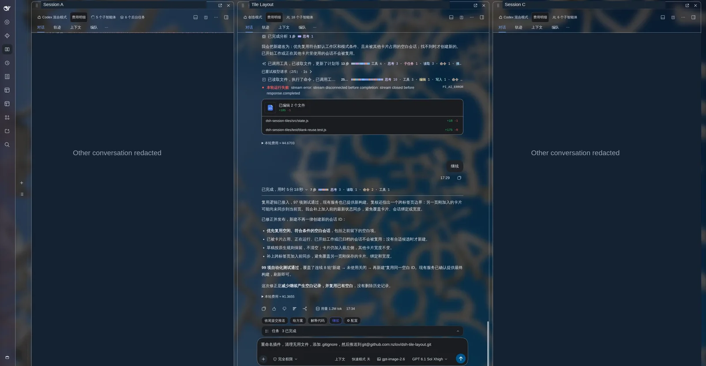

# dsh-tile-layout

Author: **nzlov**

[简体中文](<README.zh-CN.md>)

A session-tiling panel for DSH Web. Keep several complete native conversations side by side, with independent widths, ordering, plugins, and right sidebars.



*Preview based on a user-provided screenshot. Session titles and other conversations have been redacted; this processed image is not evidence of a new browser test.*

## Installation

Requires DSH Web `>=0.2.2-rc.4 <0.3.0`.

### From GitHub

Open **Plugins → Add plugin** in the DSH sidebar and enter:

```text
git+https://github.com/nzlov/dsh-tile-layout.git#main
```

Install and enable the plugin. If DSH requests a restart, restart the Web service, then refresh the browser.

Alternatively, run this command on the DSH host:

```sh
dsh plugin --profile web add 'git+https://github.com/nzlov/dsh-tile-layout.git#main'
```

Replace `web` if you use another profile. These instructions install from GitHub, not from an npm registry release.

### From a local package

```sh
git clone https://github.com/nzlov/dsh-tile-layout.git
cd dsh-tile-layout
npm run build
npm run check
npm test
npm pack
```

Enter the generated `.tgz` file's absolute path in **Plugins → Add plugin**, or install it on the DSH host:

```sh
dsh plugin --profile web add '/absolute/path/to/dsh-tile-layout-<version>.tgz'
```

Replace the placeholder with the actual archive path. If your browser runs on another machine, the path must be accessible to the DSH host.

## Usage and features

Open the session-tiling panel from the sidebar. The slim left rail has two vertically centered buttons:

- **＋ New conversation** uses the default workspace and prepends a card. It first tries a suitable, unoccupied blank session; otherwise it creates one. Occupied, running, retained, archived, and subagent sessions are excluded from reuse. Unsent drafts are kept. For legacy profiles without a registered default workspace, DSH's own Host default directory is used—not a guessed or fixed directory.
- **Choose sessions** opens a searchable modal to select conversations and adjust their order. Newly selected sessions are also prepended and revealed when the modal closes. Existing desktop cards stay mounted while the picker is open. The tile button in an ordinary conversation header can also add or remove that conversation.

### Layout

- **Desktop:** a single horizontal row, with each card at least **340 px** wide. Overflow scrolls horizontally; height fills the available area. Every card remembers its own pixel width. Adding, removing, or reordering cards does not redistribute the others' widths.
- **Resize and reorder:** drag a card's title handle to reorder. Each divider, including the trailing edge, resizes only the card to its left. Divider decoration appears on hover, focus, or drag. Double-click resets that card to **380 px**. There are no height handles.
- **Mobile:** one card at a time. Swipe through non-interactive conversation space, or use the previous/next buttons inside the title row. Inputs, menus, code blocks, and sidebars retain their own gestures.

### Native conversations and persistence

Each card embeds the real, same-origin DSH page: native conversation controls, views, menus, enabled plugins, and the full right sidebar. Files, PDF, web, terminal, and other sidebar types depend on the corresponding installed plugins. The outer card title replaces only the duplicate embedded breadcrumb; native controls remain available.

Selection, order, pixel widths, and current root-session bindings use `localStorage`. The active tiling-page marker uses tab-local `sessionStorage`: F5 restores the panel when it was active, without forcing it open after you deliberately leave. A blank that becomes a working session keeps its card identity while the saved root binding follows the actual session. Temporary subagent navigation does not replace that saved root.

Cards use transparent structural layers over one shared outer background and filter. Native input, menu, and dialog surfaces retain their backgrounds for readability. Embedded navigation is isolated from the outer page's last-opened-session preference; native drafts and other settings are preserved.

## Limits and lifecycle

- Same-origin iframes must be allowed by the DSH deployment and reverse proxy. Full native pages use more memory and connections than a chat-only view.
- New views load lazily near the viewport. Loaded desktop views stay mounted while scrolled out of view; removing a card or leaving the panel unmounts it.
- Switching mobile cards remounts the native page. Persisted native drafts can be restored; transient scroll positions are not guaranteed.
- Layout preferences are browser-local, not cross-device synchronization.
- Closing a card only removes it from the layout: it does **not** delete, archive, or stop the session. Unselected blank sessions are filtered out of the picker; filtering and reuse are **not cleanup or deletion**. Reuse does not clear drafts.

## Development

After changing client sources or locale resources, run `npm run build`, `npm run check`, and `npm test` before packing. The generated [client.js](<client.js>) is the installable browser entry and uses the Host's React instance. It **must remain tracked in Git and included in packages**; do not ignore it.

## Upgrading from `dsh-session-tiles`

Disable or uninstall the old `dsh-session-tiles` plugin before enabling `dsh-tile-layout`, so two copies do not register the same panel. The renamed package retains the legacy panel identity and browser-storage keys. Keep your existing browser preferences; do not clear storage as part of the upgrade.

[MIT License](<LICENSE>) · Copyright © 2026 nzlov.
