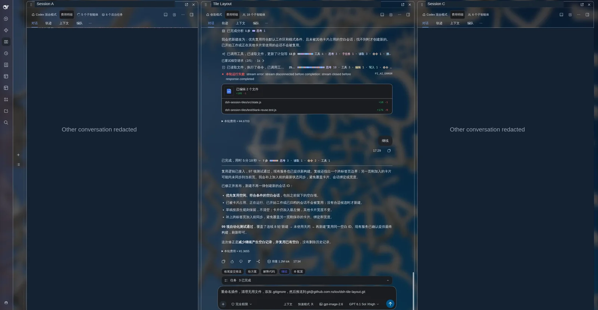

# dsh-tile-layout

作者：**nzlov**

[English](<README.md>)

为 DSH Web 添加会话平铺面板。多个完整原生会话可并排使用，各自保留宽度、顺序、插件与右侧栏。



*预览基于用户提供的截图，会话标题及其他会话内容已脱敏；此处理图不代表另一次实际浏览器实测。*

## 安装

需要 DSH Web `>=0.2.2-rc.4 <0.3.0`。

### 从 npm 安装

在 DSH 侧栏打开 **插件 → 添加插件**，输入 `dsh-tile-layout`，然后安装并启用。也可以在 DSH 服务端执行：

```sh
dsh plugin --profile web add dsh-tile-layout
```

若使用其他 profile，请将 `web` 换成实际名称。如果 DSH 提示需要重启，请重启 Web 服务后刷新浏览器。

### 从 GitHub 安装

在 DSH 侧栏打开 **插件 → 添加插件**，输入：

```text
git+https://github.com/nzlov/dsh-tile-layout.git#main
```

安装并启用插件。如果 DSH 提示需要重启，请重启 Web 服务后刷新浏览器。

也可以在运行 DSH 的机器上执行：

```sh
dsh plugin --profile web add 'git+https://github.com/nzlov/dsh-tile-layout.git#main'
```

若使用其他 profile，请将 `web` 换成实际名称。GitHub 方式跟随 `main` 分支；如需已发布的安装包，请使用上面的 npm 方式。

### 从本地安装包安装

```sh
git clone https://github.com/nzlov/dsh-tile-layout.git
cd dsh-tile-layout
npm run build
npm run check
npm test
npm pack
```

在 **插件 → 添加插件** 中填写生成的 `.tgz` 文件绝对路径，或在 DSH 服务端执行：

```sh
dsh plugin --profile web add '/absolute/path/to/dsh-tile-layout-<version>.tgz'
```

请将占位符替换为实际安装包路径。若浏览器与 DSH 服务不在同一台机器，必须使用 DSH 服务端可访问的路径。

## 使用与功能

从侧栏打开会话平铺面板。左侧细栏有两个垂直居中的入口：

- **＋新建会话**：使用默认工作区，将卡片加入最左侧。优先复用符合条件且未被占用的空白会话，没有时才创建；已在卡片中使用、正在运行、仍有活动引用、已归档或属于子会话的条目不会被复用。未发送草稿保留。旧 profile 若没有登记默认工作区，则使用 DSH Host 自身的默认目录，不猜测或创建某个固定目录。
- **选择会话**：打开可搜索的弹窗，勾选会话并调整顺序。新选中的会话同样加入最左侧，关闭弹窗后定位到它；弹窗打开期间，已有桌面卡片保持挂载。也可从普通会话顶部的平铺按钮加入或移出会话。

### 布局

- **桌面**：单行横向平铺，每张卡片最窄 **340 px**；放不下时横向滚动，高度铺满可用区域。各卡片独立记住像素宽度，新增、移除或排序都不会重新分配其他卡片的尺寸。
- **调宽与排序**：拖动标题栏手柄排序。每条分隔线，包括最右侧边缘，都只调整它左侧卡片的宽度；装饰仅在悬停、聚焦或拖动时显示。双击将该卡片恢复为 **380 px**，不提供高度手柄。
- **手机**：一次显示一张卡片，可在非交互会话区域左右滑动，或使用标题行内的上一个／下一个按钮。输入框、菜单、代码块和侧栏保留各自的手势操作。

### 原生会话与持久化

每张卡片嵌入真实的同源 DSH 页面，保留原生会话控件、视图、菜单、已启用插件和完整右侧栏。文件、PDF、网页、终端等侧栏类型由对应的已安装插件提供。外层卡片标题只替代内嵌页面重复的面包屑标题，不移除原生控件。

选择、顺序、像素宽度和当前根会话绑定保存在 `localStorage`。平铺页面的激活标记使用标签页独立的 `sessionStorage`：停留在平铺时 F5 会恢复该面板，主动离开后不会强制打开。空白页进入实际工作会话后，卡片身份保持不变，保存的根绑定跟随实际会话；临时查看子会话不会替换该根绑定。

卡片结构层透明，共用外层的一份背景和滤镜；输入框、菜单及弹窗保留原生表面底色，确保可读性。内嵌导航不会覆盖外层页面“上次打开会话”的偏好，原生草稿及其他设置保持不变。

## 边界与生命周期

- DSH 部署与反向代理必须允许同源 iframe。完整原生页面的内存与连接开销高于只嵌入聊天内容的视图。
- 新视图接近可见区域才首次加载；已加载的桌面视图滚出可见区域后仍保持挂载，移出卡片或离开面板时卸载。
- 手机切换卡片会重新挂载原生页面，可恢复已持久化的原生草稿，但不保证保留临时滚动位置。
- 布局偏好保存在当前浏览器，不跨设备同步。
- 关闭卡片只将会话移出布局，**不会删除、归档或停止会话**。选择列表过滤未选中的空白会话；过滤与复用**不等于清理或删除**，也不会清空草稿。

## 开发

修改客户端源码或语言资源后，打包前请运行 `npm run build`、`npm run check` 和 `npm test`。生成的 [client.js](<client.js>) 是可安装的浏览器入口，使用 Host 提供的 React 实例；**必须跟踪到 Git 并随安装包发布，不能将它加入忽略规则**。

[MIT 协议](<LICENSE>) · 版权所有 © 2026 nzlov。
